  

<h1 align="center">Hi there 👋</h1>

  <b>Full-stack developer</b> who writes <b>TypeScript</b> from the database to the pixel, mostly by mistake.

  💸 Passions, in strict order: <b>money</b>, <b>women</b>, and <code>git push --force</code> on Friday at 6 PM. 
  🐶 I have way more empathy for animals than for humans. A pigeon has never asked me to “quickly fix one thing in prod”. 
  🦆 Gender: <b>duck</b>. Pronouns: <i>quack/quack</i>. Please respect my identity, I've been waddling through life since birth. 
  🛋️ I don't like doing anything. Even doing nothing, I don't like. I'm currently looking for something that does less than nothing. 
  📉 No one is going to read this bio anyway. If you made it this far, you have more free time than me.

  ⚠️ <b>Recruiters &amp; my current girlfriend</b>: before calling a lawyer, please type
  <a href="https://www.google.com/search?q=second+degr%C3%A9"><b>second degré</b></a> to spare my life. 🙏

  
  
  

  

---

## 🧑‍💻 About me

| | |
|---|---|
| 🌱 | Currently learning **Rust** |
| 👯 | Looking to collaborate on **TypeScript** projects |
| 💬 | Ask me about **React**, **Node.js** & **NestJS** |
| ⚡ | Fun fact: I'm looking for **1 500 000 $** 💸 |

---

## 🚀 Featured Projects

<table>
  <tr>
    <td width="50%" valign="top">
      <h3>🏛️ <a href="https://github.com/sosso21/plan-architecture-makhlouf">Plan Architecture</a></h3>
      
Interactive 3D architectural mock-ups generated from floor plans: level cuts, exploded view, facades & sun-time simulation, downloadable PDF and <code>.glb</code> models.

      

        
        
        
      

      <a href="https://plan-architecture-makhlouf.sofianetop21-st.workers.dev/youssef-oued-ksari"><b>🔗 Live preview</b></a>
    </td>
    <td width="50%" valign="top">
      <h3>🇩🇿 <a href="https://github.com/sosso21/dz-distribution-2026">DZ Distribution API</a></h3>
      
Production-ready REST API exposing Algeria's administrative divisions — wilayas, daïras and communes — following the 2026 reorganization.

      

        
        
        
      

      <a href="https://dz-distribution-2026.vercel.app"><b>🔗 Live API</b></a>
    </td>
  </tr>
  <tr>
    <td width="50%" valign="top">
      <h3>🖼️ <a href="https://github.com/sosso21/blur-to-4k">Blur to 4K</a></h3>
      
AI image upscaling with Real-ESRGAN (x4): turns blurry, low-resolution pictures into sharp 4K images from a Jupyter notebook.

      

        
        
        
      

    </td>
    <td width="50%" valign="top">
      <h3>🐍 <a href="https://github.com/sosso21/snak-reinfircement">Snake Reinforcement</a></h3>
      
A Snake game where an agent learns to play by itself through deep reinforcement learning (Deep Q-Learning).

      

        
        
        
      

    </td>
  </tr>
  <tr>
    <td width="50%" valign="top">
      <h3>🗜️ <a href="https://github.com/sosso21/Image-compressor">Image Compressor</a></h3>
      
Batch-converts images to WEBP and generates blurred thumbnails, fully dockerized with JupyterLab — one-command startup, no local Python needed.

      

        
        
        
      

    </td>
    <td width="50%" valign="top">
      <h3>🕷️ <a href="https://github.com/sosso21/guichet-emplois">Guichet Emplois Scraper</a></h3>
      
Bot that scrapes job offers from the Canadian <i>Guichet-Emplois</i> job board by title and province, and stores them in MySQL.

      

        
        
        
      

    </td>
  </tr>
  <tr>
    <td width="50%" valign="top">
      <h3>📈 <a href="https://github.com/sosso21/posthog-self-host">PostHog Self-Host</a></h3>
      
Production deployment guide for a self-hosted PostHog on WSL2 / Linux, using the official versioned images instead of the dev repository.

      

        
        
        
      

    </td>
    <td width="50%" valign="top">
      <h3>🖱️ <a href="https://github.com/sosso21/reset-cursor">Reset Cursor</a></h3>
      
Step-by-step procedure and scripts for a clean reinstallation of the Cursor editor on Windows.

      

        
        
      

    </td>
  </tr>
</table>

---

## 🛠️ Languages & Tools

<b>Languages & Backend</b>  
  

<b>Frontend</b>  
  

<b>Databases & Messaging</b>  
  

<b>Tooling, DevOps & AI</b>  
  

---

## 📊 GitHub Stats

  
  

  

  

---

  

